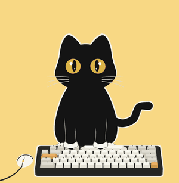

# KeyCat

一只趴在键盘上的桌面猫：你打字它伸爪按键，动鼠标它扭头看，摸头会闭眼，没人理会睡着，被烦到会用尾巴捶桌。支持 macOS 13+ 和 Windows 10+，除了从 GitHub 检查和下载更新，不联网。



上游在线演示：<https://ellobodk.github.io/KeyCat/>，可以直接用键盘鼠标逗猫。KeyCat-win 的安装包见下方 Windows 下载链接。

## 安装

**macOS**：在终端执行

```sh
curl -L -o /tmp/KeyCat-macOS.zip https://github.com/ElloboDK/KeyCat/releases/latest/download/KeyCat-macOS.zip \
  && unzip -qo /tmp/KeyCat-macOS.zip -d /Applications && open /Applications/KeyCat.app
```

首次启动需在「系统设置 → 隐私与安全性 → 输入监控」里允许 KeyCat，然后重启应用。它只读取哪个键被按下，不记录输入内容。手动从浏览器下载时，若提示「已损坏」，执行 `xattr -dr com.apple.quarantine /Applications/KeyCat.app`。装在「应用程序」文件夹里的 KeyCat 会自动更新：启动 15 秒后和之后每 6 小时检查一次，有新版就在后台下载，退出时替换，也可以在菜单里点「重启并更新」。1.0.2 及更早的版本没有这个功能，需要用上面的命令重装一次。

**Windows**：从 [KeyCat-win Releases](https://github.com/CalesvolChen/KeyCat-win/releases) 下载 `KeyCat-Windows-Setup.exe` 运行。SmartScreen 拦截时点「更多信息 → 仍要运行」。安装包只有几 MB，猫由系统自带的 WebView2 绘制，极少数没装 WebView2 的 Win10 会在安装时自动下载。安装版启动约 15 秒后检查更新，之后每 6 小时检查一次，也可以在托盘菜单中点击「检查更新」。发现新版后会下载安装，完成后自动重新打开 KeyCat。此前从上游仓库安装的版本需要手动安装一次 KeyCat-win，才能接收这个仓库的更新。

## 使用

猫住在菜单栏（Windows 是托盘）。右键猫或点图标打开菜单，可以换毛色和外观、调大小、设置多久睡着，在「调节反应…」里调整烦躁和好奇的灵敏度。按住猫身体可以拖动位置。直播或录屏时可以打开「鼠标穿透」，点击会直接落到猫下面的窗口，猫照常显示和反应，这时菜单只能从菜单栏或托盘图标打开。

Windows 上很多游戏以管理员身份运行，普通权限的 KeyCat 收不到发给它们的按键，猫就不动了。在菜单里打开「以管理员身份运行」，KeyCat 会弹出 UAC 授权并以管理员身份重启。开机自启这时改用计划任务，登录时直接以管理员身份启动，不弹 UAC；手动启动也会经由这个计划任务，同样不弹。没开开机自启时没有计划任务，每次手动启动都会弹 UAC。关掉这个选项后，要等 KeyCat 下次启动才恢复成普通权限。以管理员身份运行时，普通权限的程序按窗口抓不到猫（Windows 不让低权限程序读高权限窗口的画面），录屏请用整屏采集。独占全屏的游戏会盖住所有窗口，这种情况下猫本身就看不到，请把游戏改成无边框窗口模式。

## 构建

```sh
sh mac/build.sh       # → build/KeyCat.app（通用二进制，需 Xcode 命令行工具）
sh mac/package.sh     # → dist/KeyCat-macOS.zip + .sha256 + latest-mac.json

cd win && npm ci
npm start             # 本机调试
npm run dist          # → win/target/release/bundle/nsis/KeyCat_<版本>_x64-setup.exe（需 Rust 和 Node.js 22+，在 Windows 上执行）
```

mac 版用 `signing/` 里自动生成的本地证书签名，这样重新编译后「输入监控」授权仍然有效。mac 自动更新只接受同一张证书签名的新版，所以发布包必须在有这个目录的机器上打，证书丢了已安装的 mac 版也收不到更新。Windows 自动更新使用 `signing/tauri-updater.key` 和 `signing/tauri-updater.password` 签名。公钥写在 `win/tauri.conf.json`。请备份私钥和密码，切换签名密钥会导致已安装的版本收不到更新。不要提交 `signing/`。

## 发布

### Windows 版本规则

- 同步上游、合并代码和本地测试时，保留当前 KeyCat-win 版本号。可以把多次同步合在一次发布里。
- 准备向 Windows 用户发布时，以 KeyCat-win Releases 已发布的最高版本号为基准递增。修复通常递增补丁号，例如本仓库已发 `1.0.6`，同步了上游 `1.0.4` 的修复后，可以发布 `1.0.7`，并在发布说明里记录上游版本或提交。
- 首个 Release 的版本号应高于需要接收更新的现有安装版。例如现有安装版是 `1.0.3` 时，可以从 `1.0.4` 开始发布。
- 合并上游时保留本仓库的 Windows 更新地址、签名公钥和发布配置，确保已安装的 KeyCat-win 能继续收到更新。

### Windows 发布流程

Windows 版从 KeyCat-win 的 Releases 读取 `latest.json`。发布前，在仓库的 **Settings → Secrets and variables → Actions** 中添加 `TAURI_SIGNING_PRIVATE_KEY` 和 `TAURI_SIGNING_PRIVATE_KEY_PASSWORD`，分别使用 `signing/tauri-updater.key` 和 `signing/tauri-updater.password` 的内容。

1. 修改 `win/package.json` 的 `version`，并在 `win/` 执行 `npm install --package-lock-only` 同步锁文件版本。
2. 将版本改动提交到 main，推送对应的 `vX.Y.Z` 标签。GitHub Actions 会签名安装包，并在同一条 Release 上传 `KeyCat-Windows-Setup.exe`、`latest.json` 和供旧版 Electron 更新器使用的 `latest.yml`。

### macOS 发布流程

macOS 版的发布和更新仍使用上游仓库。打包时分别更新 `mac/Info.plist` 的 `CFBundleShortVersionString` 和 `CFBundleVersion`，再执行 `sh mac/package.sh`。macOS 更新器用 `CFBundleVersion` 判断新旧版本。

## 目录

```
mac/    macOS 外壳（Swift）：浮窗、菜单、键鼠监听、自动更新、构建/签名/打包脚本
win/    Windows 外壳（Tauri，Rust）：托盘、全局键鼠钩子、自动更新，页面由系统 WebView2 绘制
web/    两端共用的 three.js 场景：猫、键盘、动作，tuning.js 是可调参数的唯一来源
site/   下载页，由 .github/workflows/pages.yml 连同 web/ 一起部署到 GitHub Pages，每 3 小时刷新一次下载量
tools/  开发用渲染脚本（serve.py 起本地服务，readme_gif.py 生成 README 动图，其余脚本在内置浏览器里截图对比）
```

## 说明

这是一个从零实现的学习项目，形象和交互参考了一款付费桌面宠物应用，仅供个人使用和内部交流，不用于商业分发，也不包含对方的任何素材。three.js 为 MIT 许可（见 `web/THREE_LICENSE`），Tauri 为 MIT / Apache-2.0 双许可。
